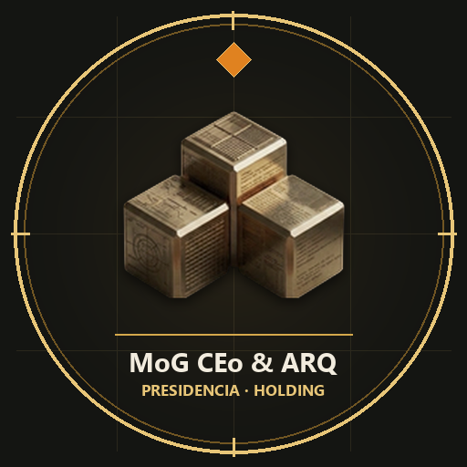
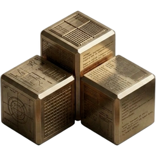

  

# 🔶 D. Miguel Ortega (`MoG CEo & ARQ`) · Presidencia y Arquitectura · MoG CORPORATION

**Identidad Soberana:** [`mortega-spec`](https://github.com/mortega-spec) (`🔶 MoG CEo & ARQ`)  
**Holding Empresarial:** **MoG CORPORATION** · **01 - Eco-Logics Control Clima S.L.** · **02 - Ingeteyco S.L.** · **Inversiones MoG S.L.**  
**Sede Corporativa GitHub:** [`https://github.com/mog-corporation`](https://github.com/mog-corporation)

---

## 1. Autoridad Rectora y Federación Canónica (`31/10/2026`)
- Las Reglas de Organización de **MoG CORPORATION** emanan directamente de Presidencia y rigen de forma uniforme en todas las empresas del grupo, sus identidades corporativas y las distintas plataformas agénticas integradas (**Claude**, **ChatGPT/Codex**, **Gemini/Antigravity**, **Qoder**, **Copilot**).
- **Trato Presidencial e Invariantes Visuales:** trato formal de **usted**, cero frases de complacencia, grafía inmutable **`MoG`** y **`MoG CEo`** (`o` minúscula), Design System **«El Norte»** y emblema **`🔶`** reservado en exclusiva a Presidencia.

## 2. Arquitectura Cuatripartita de Cuentas GitHub en `mog-corporation`

| Cuenta GitHub | Grupo de Credencial | Rol Institucional |
|---|---|---|
| [`mortega-spec`](https://github.com/mortega-spec) | `mog-ceo-eco` | Presidencia, Arquitectura Rectora (`🔶 MoG CEo & ARQ`), decisiones de seguridad/IAM y Federación del Holding |
| [`mogautomation-arch`](https://github.com/mogautomation-arch) | `mog-automation` | Escritura técnica, empuje de ramas (`WIP=1`), sincronización multi-repo y orquestación MESA (`🔸 MoGbot...`) |
| [`mog-verificador`](https://github.com/mog-verificador) | `mog-verificador` | Verificador Independiente del Stack (`writer != verifier`, medición de `HEAD` exacto y dictámenes en solo lectura) |
| [`Ingeteyco`](https://github.com/Ingeteyco) | `02-ingeteyco` | Identidad corporativa de **02 - Ingeteyco S.L.** (Ingeniería Industrial, PCI y Telegestión) |

## 3. Canales Soberanos de Gobierno
- **Organización Pública:** [`mog-corporation`](https://github.com/mog-corporation) · [`mog-corporation/.github`](https://github.com/mog-corporation/.github)
- **Anuncios Oficiales:** `mog-corporation/mog-universe/discussions/481`
- **Tablón General y Padrón Activo:** `mog-corporation/mog-universe/discussions/482`
- **Banco de Ideas e I+D+i:** `mog-corporation/mog-universe/discussions/483`
- **FAQs Doctrinales y Operativas:** `mog-corporation/mog-universe/discussions/484`
- **Tablero HMI Vivo (`FULL_LIVE_AUTO_MoG`):** `mog-corporation/mog-universe/issues/269`

---

   
  <strong>🔶 MoG CEo & ARQ</strong> · Presidencia y Dirección Ejecutiva · <strong>MoG CORPORATION</strong>

